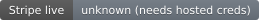

# Spellwake

Work in progress: a browser and Tauri tabletop application. The current preview uses sample game state; it is not a connected multiplayer match.

Use Bun 1.3.11 and the Rust toolchain pinned in `rust-toolchain.toml`. Run `bun install --frozen-lockfile`, `bun run play:check`, `bun run play:test`, and `cargo test --workspace` for source checks. Runtime artwork is supplied separately and is not included in this repository.

## Build & Card Support

[](https://github.com/Spellwake/spellwake/actions/workflows/tauri.yml)
[](https://github.com/Spellwake/spellwake/actions/workflows/rust.yml)
[](https://github.com/Spellwake/spellwake/actions/workflows/application-api.yml)
[](https://github.com/Spellwake/spellwake/actions/workflows/domain-health.yml)
[](https://github.com/Spellwake/spellwake/actions/workflows/catalog-refresh.yml)


## Parser Audit & Testing Kit

Stage 1 Oracle parsing (`crates/oracle_compiler`) is verified on three distinct axes rather than a single parse-count number:

- **Parser (Strict Parse)**: ordinary base-format cards parsed with zero `ParseFailureAst` entries and `allow_tabletop_honor_system=false`.
- **Parser Audit**: automated full-corpus structural and semantic invariant check (`spellwake-oracle-audit`) gating zero critical defects (no Rust `Debug` leaks, no keyword hijacks, no empty modal shells, no bad mana choices, no spurious `MODIFIED` flag collisions, no empty non-vanilla faces, and no honor-system leaks).
- **Parser (Pure Typed AST)**: cards compiled purely into typed AST nodes with zero opaque prose fallbacks or uncompiled embedded abilities.

Run the permanent real-card semantic test suite or full-corpus CLI auditor locally:

```sh
RUST_MIN_STACK=67108864 cargo test --locked -p spellwake-oracle-compiler --test real_card_semantic_suite -- --nocapture
RUST_MIN_STACK=67108864 cargo run --locked --release -p spellwake-oracle-compiler --bin spellwake-oracle-audit -- audit-corpus --snapshot <oracle-cards.jsonl.gz> --vocab <creature-vocabulary.input.json> --max-critical 0
```

## System Health

All domain test suites and declarative Rules Engine benchmarks are organized under [`tests/`](tests/README.md) via [`tests/registry.json`](tests/registry.json).

| Domain | Local CI | Live |
| --- | --- | --- |
| **Patreon** |  |  |
| **Stripe** |  |  |
| **Matchmaking** |  |  |
| **Predictions** |  |  |
| **Market** |  |  |
| **Cosmetics** |  |  |
| **Account & Auth** |  |  |
| **Decks & Collection** |  |  |
| **Custom Cards** |  |  |
| **Social & Messaging** |  |  |
| **League & Progression** |  |  |
| **Rendering** |  |  |
| **Oracle Parser** |  |  |
| **Rules Engine** |  |  |
| **AI** |  |  |

Updated automatically from `main` and daily CI (`badges` branch). Live checks require hosted secrets; within Cosmetics, the `pets` subdomain remains unqualified (`partial` badge) until wired and approved.

<details>
<summary>Hosted credentials for live checks</summary>

- **Patreon**: `SPELLWAKE_PATREON_CLIENT_ID`, `SPELLWAKE_PATREON_CLIENT_SECRET`, `SPELLWAKE_PATREON_REDIRECT_URI`, `SPELLWAKE_PATREON_WEBHOOK_SECRET`, `SPELLWAKE_PATREON_EVIDENCE_BUCKET`
- **Stripe**: `SPELLWAKE_STRIPE_SECRET_KEY`, `SPELLWAKE_STRIPE_WEBHOOK_SECRET`, `SPELLWAKE_STRIPE_API_VERSION`, `SPELLWAKE_STRIPE_EVIDENCE_BUCKET`
- **AI**: `SPELLWAKE_AI_PROVIDER`, `OPENAI_API_KEY` / `ANTHROPIC_API_KEY` / `GEMINI_API_KEY`, `LANGFUSE_PUBLIC_KEY`, `LANGFUSE_SECRET_KEY`, `LANGFUSE_BASE_URL`
- **Hosted API & Storage**: `SPELLWAKE_SUPABASE_URL`, `SPELLWAKE_SUPABASE_PUBLISHABLE_KEY`, `SPELLWAKE_SUPABASE_SECRET_KEY`, `SPELLWAKE_APPLICATION_API_URL`, `SPELLWAKE_ROOM_INVITATION_KEY`, `SPELLWAKE_RECONCILE_SECRET`, `SPELLWAKE_PRICE_BUCKET`, `SPELLWAKE_CATALOGUE_BUCKET`

</details>

No software license is granted by publishing this source. Magic: The Gathering and its card imagery belong to Wizards of the Coast and their respective artists. This is unofficial fan content, not approved or endorsed by Wizards. Third-party dependencies retain their own licenses.
