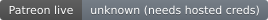
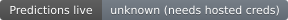

# Spellwake

Work in progress: a browser and Tauri tabletop application. The current preview uses sample game state; it is not a connected multiplayer match.

Use Bun 1.3.11 and the Rust toolchain pinned in `rust-toolchain.toml`. Run `bun install --frozen-lockfile`, `bun run play:check`, `bun run play:test`, and `cargo test --workspace` for source checks. Runtime artwork is supplied separately and is not included in this repository.

## Build & Card Support

## System Health

| Domain | Local CI | Live |
| --- | --- | --- |
| **Patreon** |  |  |
| **Stripe** |  |  |
| **AI** |  |  |
| **Matchmaking** |  |  |
| **Predictions** |  |  |
| **Market** |  |  |
| **Pet cosmetics** |  |  |

Updated automatically from `main` and daily CI (`badges` branch). Live checks require hosted secrets; pet cosmetics are not wired yet.

Hosted credentials for live checks

- **Patreon**: `SPELLWAKE_PATREON_CLIENT_ID`, `SPELLWAKE_PATREON_CLIENT_SECRET`, `SPELLWAKE_PATREON_REDIRECT_URI`, `SPELLWAKE_PATREON_WEBHOOK_SECRET`, `SPELLWAKE_PATREON_EVIDENCE_BUCKET`
- **Stripe**: `SPELLWAKE_STRIPE_SECRET_KEY`, `SPELLWAKE_STRIPE_WEBHOOK_SECRET`, `SPELLWAKE_STRIPE_API_VERSION`, `SPELLWAKE_STRIPE_EVIDENCE_BUCKET`
- **AI**: `SPELLWAKE_AI_PROVIDER`, `OPENAI_API_KEY` / `ANTHROPIC_API_KEY` / `GEMINI_API_KEY`, `LANGFUSE_PUBLIC_KEY`, `LANGFUSE_SECRET_KEY`, `LANGFUSE_BASE_URL`
- **Hosted API & Storage**: `SPELLWAKE_SUPABASE_URL`, `SPELLWAKE_SUPABASE_PUBLISHABLE_KEY`, `SPELLWAKE_SUPABASE_SECRET_KEY`, `SPELLWAKE_APPLICATION_API_URL`, `SPELLWAKE_ROOM_INVITATION_KEY`, `SPELLWAKE_RECONCILE_SECRET`, `SPELLWAKE_PRICE_BUCKET`, `SPELLWAKE_CATALOGUE_BUCKET`

No software license is granted by publishing this source. Magic: The Gathering and its card imagery belong to Wizards of the Coast and their respective artists. This is unofficial fan content, not approved or endorsed by Wizards. Third-party dependencies retain their own licenses.
