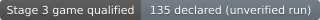

# Spellwake

Work in progress: a browser and Tauri tabletop application. The current preview uses sample game state; it is not a connected multiplayer match.

Use Bun 1.3.11 and the Rust toolchain pinned in `rust-toolchain.toml`. Run `bun install --frozen-lockfile`, `bun run play:check`, `bun run play:test`, and `cargo test --workspace` for source checks. Runtime artwork is supplied separately and is not included in this repository.

## Build & Card Support

[](https://github.com/Spellwake/spellwake/actions/workflows/tauri.yml)
[](https://github.com/Spellwake/spellwake/actions/workflows/rust.yml)
[](https://github.com/Spellwake/spellwake/actions/workflows/application-api.yml)
[](https://github.com/Spellwake/spellwake/actions/workflows/domain-health.yml)
[](https://github.com/Spellwake/spellwake/actions/workflows/catalog-refresh.yml)




## What We Test & What Passes

Every test suite and benchmark manifest is registered under [`tests/`](tests/README.md) via [`tests/registry.json`](tests/registry.json) and reported automatically by CI (zero-test runs and unqualified subdomains never report green):

| Pillar | What It Verifies | Status / Coverage |
| --- | --- | --- |
| **Oracle Parser (Stage 1)** | Strict parse (zero `ParseFailureAst`, `allow_tabletop_honor_system=false`), pure typed AST (zero opaque prose fallbacks), full-corpus structural/semantic audit (`0` critical defects), and permanent real-card semantic suite. |    |
| **Rules Engine & Benchmarks (Stage 2/3)** | Deterministic rules-engine regression tests, end-to-end playable card support, Stage 3 gameplay qualification, and declarative MTG interaction benchmarks (`tests/domains/rules-engine/benchmarks/`, tracked honestly as passing vs. pending). |    |
| **Application API & Postgres Integrity** | Isolated Postgres 17 RLS/RPC integrity, Stripe checkout/webhook settlement, Patreon linking/entitlements, matchmaking/rooms, trades/marketplace, predictions, cosmetics, and offline AI bot quotas. | [](https://github.com/Spellwake/spellwake/actions/workflows/application-api.yml) |
| **Frontend, 3D Tabletop & Browser E2E** | Strict TypeScript checks (`play:check`), Bun unit tests (`play:test`), Three.js WebGL2 tabletop benchmarks (`play:qualify-3d`), multi-viewport responsive layouts (`play:qualify-responsive`), and Playwright browser E2E suites per domain. |  |

Run the permanent real-card semantic test suite or full-corpus parser auditor locally:

```sh
RUST_MIN_STACK=67108864 cargo test --locked -p spellwake-oracle-compiler --test real_card_semantic_suite -- --nocapture
RUST_MIN_STACK=67108864 cargo run --locked --release -p spellwake-oracle-compiler --bin spellwake-oracle-audit -- audit-corpus --snapshot <oracle-cards.jsonl.gz> --vocab <creature-vocabulary.input.json> --max-critical 0
```

## System Health

All 15 domain suites (listed alphabetically) run automatically on `main` and daily CI (`badges` branch). Local CI runs unit, Postgres 17, and Playwright browser E2E checks; live checks require hosted secrets. Within Cosmetics, the `pets` subdomain remains unqualified (`partial` badge) until wired and approved.

| Domain | Scope | Local CI | Live |
| --- | --- | --- | --- |
| **Account & Auth** | OTP/OAuth sign-in, onboarding, sessions, preferences, deletion |  |  |
| **AI Bots** | Offline bot runtime, prompt/schema contracts, Postgres quotas/slots |  |  |
| **Cosmetics** | Card backs, sleeves, dice, playmats, wear/mat effects (`pets` pending) |  |  |
| **Custom Cards** | Compiler, studio vault, portable export/import, Patron play gate |  |  |
| **Decks & Collection** | Deck shelf/builder, imports, collection filters, pack opening |  |  |
| **League & Progression** | Seasons, ratings, leaderboards, daily quests, replays |  |  |
| **Market** | Listings, direct trades, pack supply shop, inventory integrity |  |  |
| **Matchmaking** | Queues, formats, lobbies, rooms, invitations |  |  |
| **Oracle Parser** | Stage 1 compiler, real-card semantic suite, daily Scryfall audit |  |  |
| **Patreon** | OAuth linking, webhooks, membership refresh, entitlements |  |  |
| **Predictions** | Price ingestion, orders, settlement, browser E2E |  |  |
| **Rendering** | 3D WebGL2 tabletop benchmarks, responsive UI, component gallery |  |  |
| **Rules Engine** | Mechanics regression suite and interaction benchmarks |  |  |
| **Social & Messaging** | Friends, direct messages, read receipts, match notifications |  |  |
| **Stripe** | Webhooks, checkout, settlement, billing portal, contracts |  |  |

<details>
<summary>Hosted credentials for live checks</summary>

- **AI Bots**: `SPELLWAKE_AI_PROVIDER`, `OPENAI_API_KEY` / `ANTHROPIC_API_KEY` / `GEMINI_API_KEY`, `LANGFUSE_PUBLIC_KEY`, `LANGFUSE_SECRET_KEY`, `LANGFUSE_BASE_URL`
- **Hosted API & Storage**: `SPELLWAKE_SUPABASE_URL`, `SPELLWAKE_SUPABASE_PUBLISHABLE_KEY`, `SPELLWAKE_SUPABASE_SECRET_KEY`, `SPELLWAKE_APPLICATION_API_URL`, `SPELLWAKE_ROOM_INVITATION_KEY`, `SPELLWAKE_RECONCILE_SECRET`, `SPELLWAKE_PRICE_BUCKET`, `SPELLWAKE_CATALOGUE_BUCKET`
- **Patreon**: `SPELLWAKE_PATREON_CLIENT_ID`, `SPELLWAKE_PATREON_CLIENT_SECRET`, `SPELLWAKE_PATREON_REDIRECT_URI`, `SPELLWAKE_PATREON_WEBHOOK_SECRET`, `SPELLWAKE_PATREON_EVIDENCE_BUCKET`
- **Stripe**: `SPELLWAKE_STRIPE_SECRET_KEY`, `SPELLWAKE_STRIPE_WEBHOOK_SECRET`, `SPELLWAKE_STRIPE_API_VERSION`, `SPELLWAKE_STRIPE_EVIDENCE_BUCKET`

</details>

## License

Spellwake's original software and accompanying public documentation are available under the [MIT License](LICENSE), except where a separate license is identified. You may use, modify, redistribute, and sell copies of the covered code, including in closed-source forks, subject to the license's notice requirements.

The MIT grant excludes the Spellwake name, logos, and branding, as well as artwork, cosmetic assets, and internal documentation held in the separate private repositories. Third-party material, including dependencies, bundled fonts, and separately licensed tools, remains subject to its own terms. The license does not grant rights to Magic: The Gathering materials, including card images, symbols, and card text or data obtained from or attributed to third parties. Spellwake is an independent project and is not endorsed or sponsored by Wizards of the Coast.
